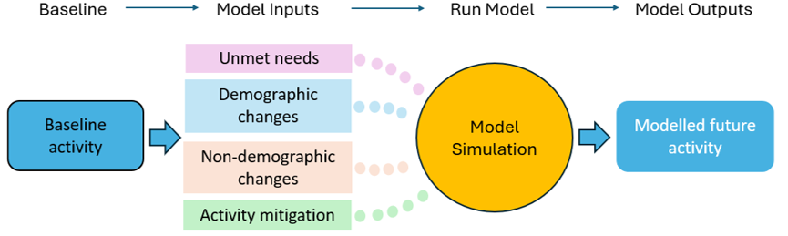

# Welcome to the OpenPlan hospital demand model documentation site.

The OpenPlan hospital demand model helps forecast future hospital demand in 
England.

The model can be used by NHS Trusts, hospital planners, service designers and 
those interested in the shift of activity from hospitals into the community.

  

:::{.callout-tip}

[ Model overview](/overview/model_summary.qmd) - For a high level overview of how the model works.

[ Technical Zone](/technical/technical.qmd) - To dig deeper into the methods, data and code.

[ Quick start guide](/quick_start/quick_start.qmd) - To understand how to run a model.

[ Model changes](/news/news.qmd)  - Click on this link for the latest model news and developments.

[ Model assurance](/assurance/assurance.qmd) - Understand how the model promotes trust and auditability.

[ FAQs](/user_guide/FAQ.qmd) - Can't find what you're looking for? 
Check the out our frequently asked questions.

:::

  

  

::: {.callout-caution}

# The NHP model is now called the "OpenPlan hospital demand model"

The Strategy Unit was originally commissioned by the New Hospital Programme to 
create a transparent, consistent way to forecast future hospital demand. 
This model continues to develop in response to feedback and emerging requirements, 
with all underpinning code published openly.

It has also been joined by several, related tools that support hospitals and 
systems to identify opportunities for 'left shift', compare their plans with 
those of peers and estimate their future capacity requirements. 
These use cases are not unique to the New Hospital Programme - they are relevant 
to all hospitals and systems in the NHS.

We have therefore made the decision to group these tools under the new heading 
'**OpenPlan**'. 
We will refer to the existing NHP demand model as the 
'**OpenPlan hospital demand model**' going forward.
:::
