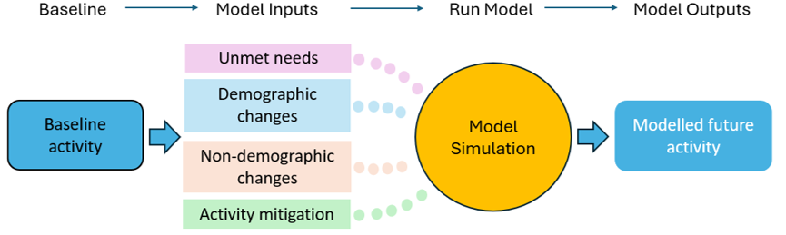
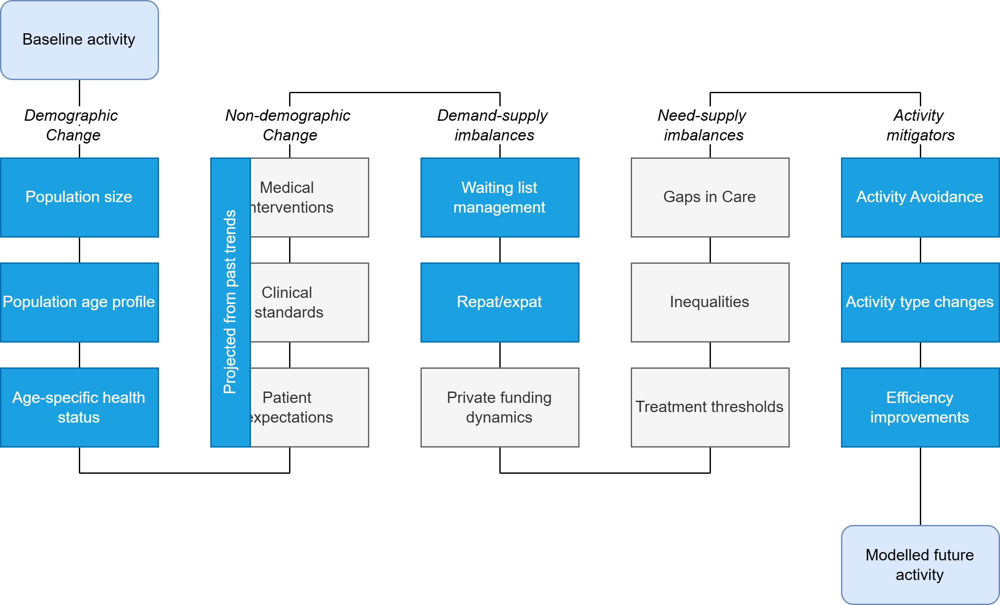

A separate one page explainer is available as a [standalone webpage](https://connect.strategyunitwm.nhs.uk/nhp_model_explainer/).

The OpenPlan hospital demand model estimates future hospital activity. 
It is a sophisticated model that factors in the inherent uncertainty associated with making forecasts about future demand. 

The model takes one full financial year (the 'baseline' year) of hospital data as the 
basis to model future hospital activity in the [horizon year](/user_guide/FAQ.qmd#which-year-should-be-selected-as-the-horizon-year), which is chosen by the user. 
Population growth predictions (published by the Office for National Statistics) are
combined with assumptions about several 'change factors', summarised in the 
diagram above, to shrink or grow the types of activity in the baseline year, based
on their user-supplied prediction intervals.

Some of the model inputs must be given in the form of ranges that describe your
assumptions about plausible levels of future activity, and the outputs provide a [principal projection](/user_guide/glossary.qmd#principal-projection) as well as a description of the variation in the estimated future activity. 
The key concept that describes hospital activity in the model is called Types of
Potentially Mitigatable Activity, or TPMAs. You can read more about these in the
[TPMAs]() section. TPMAs are the 'currency' with which users describe their assumptions
about the future.

The main [outputs](/user_guide/FAQ.qmd#how-are-outputs-provided) are high-level summary statistics such as counts of admissions, bed-days, outpatient and A&E attendances, as well as more detailed information providing a breakdown by site, activity type, age group, and treatment specialty.  

# What does the demand model NOT do? 

The demand model does **not** provide users with estimations of accommodation requirements such as the number of beds, rooms, wards, theatres etc. 
A separate tool, which works alongside the demand model, handles capacity modelling.
See the [capacity model documentation site](https://connect.strategyunitwm.nhs.uk/capacity-model-docs/) for more information.

# How does the demand model generate its outputs? 

The model uses Hospital Episode Statistics (HES) data and handles discrete hospital events rather than aggregate summaries of hospital activity. 

The model uses Monte Carlo simulations – it runs as many simulations as have been selected by the user, with the default being 256. 
In these simulations, values are sampled from each of the input parameters – these values are taken from anywhere within the prediction intervals the user has given. 
However, it assumes 'Normally distributed' parameters, which means most simulations take values around the middle of the prediction interval. 
Each simulation provides an estimation of a possible future of hospital activity at the horizon year. 

From model v2.0, it is the average (mean) of all the simulations which produces the principal projection – the most likely estimate of activity in the horizon year. 
The model outputs also inform the user of the potential variation in future activity.

For many of the outputs, the values of the lower and upper prediction intervals are also available. 
As such, the outputs of the model reflect the uncertainty in the underpinning inputs, assumptions and estimates.  

More detail on how the parameters are applied to individual records from the baseline data can be found in the chapter on [modelling uncertainty](/technical/modelling_methodology/modelling_uncertainty.qmd). More detailed methods can be found in the [technical](/technical/technical.qmd) section.

# Model inputs and outputs

## Inputs

There are two main types of inputs for the model:

### Data

-   Historical national hospital activity data: This will be sourced from Hospital Episode Statistics (HES) data, and will be the main source for input data. It provides record/person-level data on historical hospital activity.
-   ONS population and life expectancy projections: This may be supplemented by local/regional projections, such as housing growth estimates.
-   Other published data sets: This includes Referral to Treatment (RTT) data and lookup tables mapping CCGs, trusts, sites and local authorities. Note that some of these datasets (such as RTT data) will be used to provide contextual information for users setting model parameters, rather than directly driving the model engine and outputs.

For more detail on the data used in the project see the [data summary page](/technical/data_extraction/data_extraction_overview.qmd).

### Model parameters

The model takes as its parameters estimations of activity - more detail is available in the [parameters section](/user_guide/user_guide.qmd). These parameters are informed by:

-   **Expert opinion and local knowledge**\
    For example, assumptions on the impact of specific activity avoidance strategies and interventions, sometimes also known as types of potentially mitigatable activity (TPMAs). These inputs will be set locally by each Trust's representatives, but will also be informed by the results of the [NHP National Elicitation Exercise (NEE)](https://github.com/The-Strategy-Unit/nhp_elicitation_tool), which gathered through Delphi/SHELF elicitation methods an expert consensus of possible activity mitigation on a national level.

    All inputs will be sense-checked and compared across Trusts where appropriate, with any anomalies requiring further evidence to support them.

-   **Secondary analysis, modelling and research**\
    Some of the inputs will be drawn directly from available literature and studies, but several inputs, such as the non-demographic growth values, are the product of subsidiary analysis and modelling.

The model will use the estimations of activity increase/decrease found in the parameters to transform the input data into estimations of future activity.

### Outputs

The model will generate the following key outputs for each scheme and set of scenarios:

-   A description of future hospital activity levels across a range of future years, based on the principal forecast from the tool. This will contain high-level summary statistics such as counts of admissions, outpatient attendances and bed days, along with more detailed information providing a breakdown by activity type, month, specialty, patient age, diagnosis, and so on.
-   A description of the potential variation in the high-level summary statistics given the uncertainty in the underpinning inputs, assumptions and estimates.
-   A summary of input assumptions and estimates, including how central estimates and probability distributions compare with those used in modelling for other local health systems participating in the NHP.
-   A detailed extract of the full model outputs, including record level data for each scenario/run of the Monte-Carlo simulation.

Note that some of these outputs, in particular record level data, will be restricted to the NHP Demand Modelling Team, whereas other high-level summary outputs will be shared more widely with key stakeholders.
