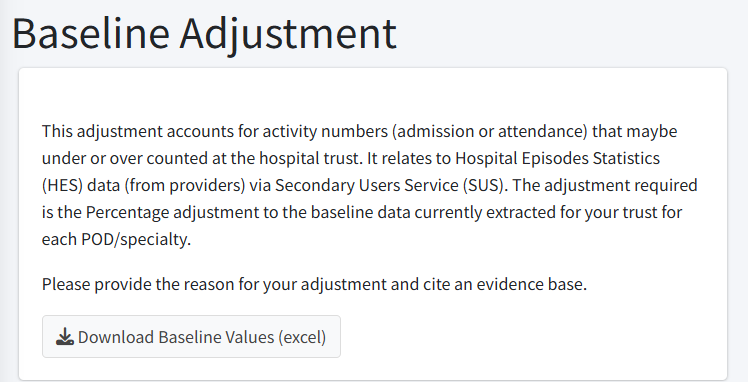

## 1. Register

To use the OpenPlan hospital demand model, you first need to register your interest
with the Strategy Unit by emailing [our inbox](mailto:mlcsu.su.datascience@nhs.net).
In this email, please name the organisation you are modelling on behalf of, including
its ODS code, and give an outline of what you want to use the model for.
Depending on the use case, a fee for use may be applicable.

Once accepted, you (and up to one other colleague) will be given a user account 
to our secure Posit Connect server.
This will allow you to access the necessary applications to run the model.

## 2. Access the inputs app

When you are notified that your account has been created, you can go to the
[inputs application](https://connect.strategyunitwm.nhs.uk/tools_list/) and begin selecting your modelling assumptions.

## 3. Reconcile your baseline data with HES

The model uses one whole financial year of hosptial data as its basis.

We know that sometimes locally held data varies from Hospital Episode Statistics (HES),
so to ensure your model results are valid, in most cases you will need to undertake
a reconciliation process to understand how the data we hold may differ from yours.
This will then be used to 'adjust' our data pre-modelling to give you the best
possible results.

To undertake this exercise, please download your data from the inputs app's
Baseline Adjustment page.

## 4. Run a model

Once you have worked through all the sections of the model inputs (thus creating
what we refer to as a model 'scenario'), you will be
able to click 'Run Model' at the bottom left of the page.

If this button is not appearing for you when expected, please [contact us](mailto:mlcsu.su.datascience@nhs.net).

:::{.callout-important}
Remember, the quality of your model results is proportionate to the care and 
consideration you give to all the assumptions you input. 
For best results, ensure you include all relevant expert opinions when setting up
your model scenario.
:::

## 5. Collect your results

Once your model has completed running, you will be redirected to the Outputs app 
where you can view and download your results.