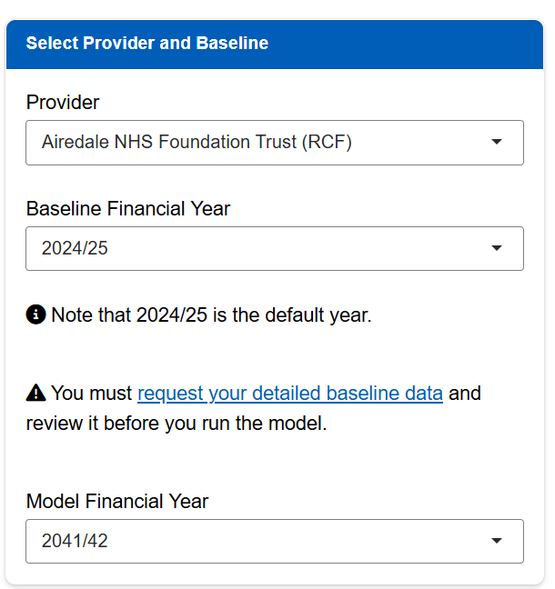
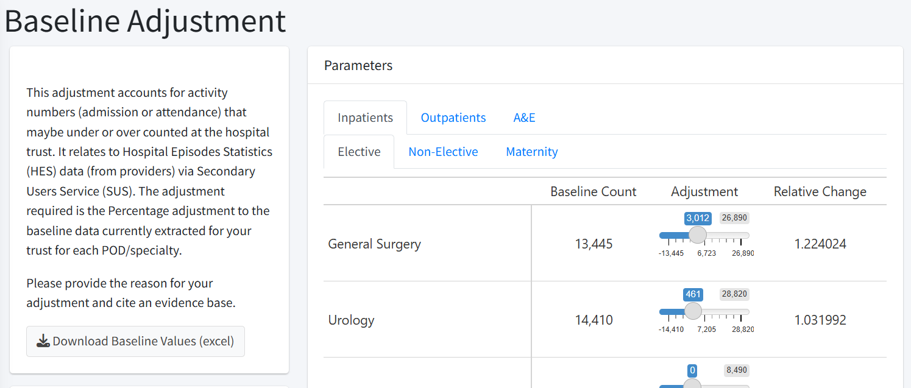
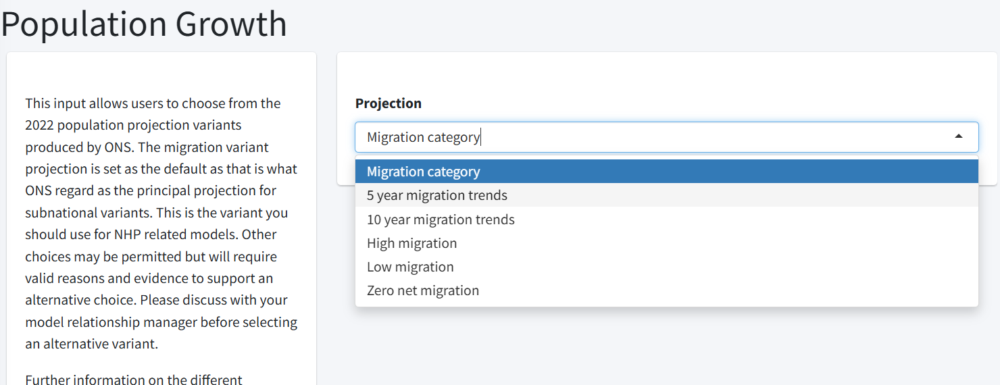
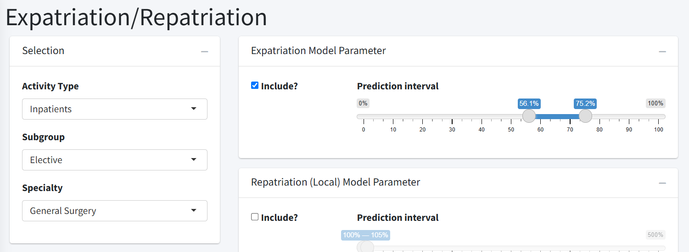
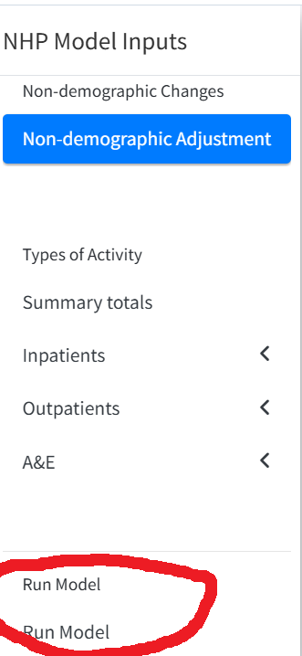

This guide explains how to use the OpenPlan capacity model, and how to receive
your results.

## 📝 Preparation 📝 

Please note, the _majority_ of user work needed to use the model occurs _before_
you begin modelling. 
It can take significant time to carry out due diligence on the scenario selections
to be used, to ensure that the results you produce are trusted, plausible and 
auditable.

#### 1. Read the [model summary](/overview/model_summary.qmd) to ensure this model can meet your needs. 
Its a good idea to choose your support team from your colleagues now.

#### 2. Register with the [Strategy Unit](../quick_start/quick_start.qmd#register) to obtain a user account.
Up to two accounts are permitted per organisation, so check whether anyone in your
team already has an account before applying.

#### 3. Identify TPMAs that align best with your mitigation plans.
You can use the [inputs app](https://connect.strategyunitwm.nhs.uk/tools_list/) or the [Explore opportunities to reduce hospital care app](https://connect.strategyunitwm.nhs.uk/tpma-explorer/) 
to understand all the TPMAs, and see how your organisation compares to your peers
in baseline year activity rates.

#### 4. Validate your baseline data.
Download your baseline data from the [inputs app](https://connect.strategyunitwm.nhs.uk/tools_list/) and check that it matches
your local data. 
If it does not, record your decisions about how you will modify the baseline
model data to allow it to better describe the activity you delivered.

#### 5. Negotiate the crucial parameters to be used.
Gather the necessary input from colleagues on your model scenario choices:

- Which future year's [('horizon year')](/user_guide/FAQ.qmd#which-year-should-be-selected-as-the-horizon-year) activity do you wish to model?
- If there is a choice of baseline years, which will you use as the basis of your modelling?
- Make a collective choice about which [population projection variant](/technical/modelling_methodology/demographic_modelling/demographic_modelling.qmd) you will use.
- Make a collective choice about which [non-demographic growth variant](/technical/modelling_methodology/non-demographic_growth.qmd) you will use.
- Gather intelligence on the volumes of activity that may be [expatriating or repatriating](/technical/modelling_methodology/demand_supply.qmd) into your Trust by the horizon year.
- For every [TPMA](/overview/TPMAs.qmd) you will include, what are the upper and lower limits of 
plausibility for the percentage of activity (the 'p10' amd'p90') you will still 
be delivering in the chosen horizon year?

----

## 🚀 Running a model scenario 🚀

#### 1. Create a model scenario

A model 'scenario' is a set of choices and assumptions that is created by you when
you use the [inputs app](https://connect.strategyunitwm.nhs.uk/tools_list/).
You can choose to create a new scenario from scratch, edit an existing one, or create
a new scenario from an existing one.

Access to the inputs app is only possible for users who have been granted access,
as described in the [quick start guide](../quick_start/quick_start.qmd#register).

#### 2. Set the Trust and model years

Once you have logged in to the app, you will be presented with a landing page
that requires you to select the Trust you are modelling on behalf of, and the
baseline year of data that will be used in the scenario.
You will also be required to selec the ['horizon' year](/user_guide/FAQ.qmd#which-year-should-be-selected-as-the-horizon-year) - this is the financial 
year whose activity you will be planning for.

{width=50%}

#### 3. Give the scenario a name

A sensible name is required - follow the [linked guidance](naming_scenarios.qmd) on how to create an
appropriate scenario name.
If you do not wish to select advanced options, you can then click 'Start' to be
taken to the next stage.
The following sections describe the modules you will find down the left hand side
of the app. 

#### 4. Baseline adjustment

Use the sliders to adjust your baseline year data to match your local data, as
decided by your [baseline reconciliation](/technical/modelling_methodology/baseline_data_validation.qmd) process.
Record a rationale for your choices, including the choice not to adjust.

#### 5. Population changes

_Population Growth_

In the population growth section, if you have [sign-off](/user_guide/FAQ.qmd#i-have-sign-off-to-use-our-own-custom-population-projections---how-do-i-submit-these-to-you) from your system to use a
non-default ONS population projection, you can select the variant you wish to use
here.

_Health Status Adjustment_

By default the model enables [this element](/technical/modelling_methodology/demographic_modelling/modelling_utilisation_rates.qmd).
You can uncheck the box if you do not wish to include health status adjustment 
in your scenario.

#### 6. Demand-supply Imbalances

You may know that certain types of activity your hospital delivered in the
baseline year will no loger be provided in the horizon year as they are being
moved to a different Trust ('Expatriation').
Similarly, you may know that, by the horizon year, your Trust will be delivering
activity that was delivered by a different provider in the baseline year ('Local repatriation' = 
both providers within the same ICB, 'Non-local reptriation' = activity from outside your
ICB will be delivered at your Trust in future).

For each type of activity that this applies to, select the relevant activity
type, subgroup and specialty. Click 'Include?' in the relevant box, and use
the sliders to show the proportion of baseline year activity you **will still be 
providing** in the horizon year.

Include text in the rationale box to explain these choices.

#### 7. Non-demographic Adjustment (NDG)

Here you can select whether you would like to use the default version of the NDG 
parameter, or the alternative.
This parameter is very influential on your results and cannot be 'switched off'.
You can [read more about NDG here](/technical/modelling_methodology/non-demographic_growth.qmd).

#### 8. Types of Activity

_Summary totals_ gives you counts of types of potentially mitigatable activity,
so that you can appreciate their relative cohort sizes (note that the groups
are not mutually exclusive).

The next three sections, _Inpatients_, _Outpatients_ and _A&E_ all detail the
data describing historical activity for your Trust for every [TPMA](/overview/TPMAs.qmd), and show this related to
your peer organisations.
For every TPMA, you can choose to include your mitigation plans for that activity
in your scenario by clicking 'Include'.
You should then use the '80% prediction interval' sliders to describe the 
plausible range of activity you will still be providing in the horion year.
Include a rationale in the box below to record relevant reasoning for your decisions.

#### 9. Run Model

Once you have completed all relevant sections (modules listed down the left hand
side of the app) you can click the 'Run Model' button.
If you do not see this button in the app, you have not been added to the relevant
permissions group.
If you believe this to be an error please [contact us](/contact.qmd).

You will be redirected to the [outputs app](https://connect.strategyunitwm.nhs.uk/tools_list/) 
when the model has completed.

-----

### Understand your results

The [outputs app](https://connect.strategyunitwm.nhs.uk/tools_list/) allows you
to explore the results produced - both the ['principal projection'](/user_guide/glossary.qmd) (the mean of
all the sets of model results per scenario) and the distribution of those model
runs.

You can download your results as a workbook or a JSON file for local inspection 
and analysis.

An example of scenario results can be downloaded [here](example_outputs.xlsx).

## Model help

### [FAQs](FAQ.qmd)

Answers to common questions about the model.

### [Glossary](glossary.qmd)

Definitions of terms and abbreviations used in this guide.